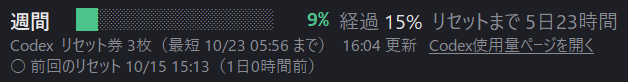

# Codex Usage Meter

Codex（OpenAI）の**週間使用量**と**5時間使用量**を、画面の端の小さな窓に常に表示するツールです。
Codex アプリを使っている間も、使い過ぎを先回りで避けられます。



実物の窓（3行目は 2026-10-15 13:55 の Tibo 氏の実際の予告投稿を当てはめた表示例。合図が無いときは2行です）


画面に置いたときのイメージ（右下に出て、ドラッグで動かせます。背景の画面は作図です）

### これは何か

**パソコンで動く小さな常駐アプリ**です（Python で書いた1ファイル）。Codex の中に入れる拡張機能ではありません。

- パソコンにログインすると自動で起動し、Codex アプリを開いていなくても動きます。
- 使用量は、Codex アプリ（または CLI）と一緒に入っている `codex` に問い合わせて読みます。そのため Codex アプリか CLI が入っていて、ChatGPT の契約でサインイン済みであることが必要です。
- 入れるときだけ Codex に導入を手伝ってもらいます（手作業でも入れられます）。

- 色は 70%未満=緑／70%以上=黄／90%以上=赤。
- **経過**は、前回のリセットから次のリセットまでの期間が、いま何%進んだかです（5時間枠は5時間、週間枠は7日）。使用%が経過%より小さければ、時間の進みより使用が少ない状態（余裕あり）です。
- 出るのは Codex が返してきた枠だけです。契約によっては週間だけで、5時間枠が返ってこないことがあります（そのときは1行です）。
- 下の行の**リセット券**は、Codex の無料リセットの残り枚数と、いちばん早く切れる券の期限です（パソコンの時刻で表示）。
- 1分ごとに更新します。Codex で会話していなくても最新の値になり、確認で使用量が減ることはありません。
- **使用量ページを開く**を押すと、Codex の使用量ページ（https://chatgpt.com/codex/settings/usage ）を既定のブラウザで開きます。Codex アプリの「設定 › 使用状況と請求」は、アプリの外からリンクで直接開けないため（2026-10 時点）、同じ内容のウェブ版を開きます。
- ドラッグで移動（位置は次回も保たれます）。右クリックで「今すぐ更新」「使用量ページを開く」「X を今すぐ読み直す」「常に手前に表示（オンのときチェック。ほかのウィンドウの下に隠れない）」「終了」。
- **版の確かめ方（0.2.1〜）**：右クリックのメニューの先頭に「Codex 使用量メーター v0.2.1」のように出ます。下の行の「Codex」の文字にマウスを乗せても出ます。不具合を相談するときは、この版を添えてください。

### リセットの合図（0.2.0〜）

Codex の使用量リセットについての X の公開投稿を10分ごとに読み、合図があるときだけ3行目を出します。

```
● ﾘｾｯﾄ予告  10/15 13:55  Tibo：The reports of my reset button being lost…
```

| 表示 | 色 | 根拠にする投稿 |
|---|---|---|
| リセット予兆 | 紫 | 元Codexリセット予報士 ついはじめ氏（[@hajimetwi3](https://x.com/hajimetwi3)）の予想・期待のメモ |
| リセット予告 | 水色 | OpenAI の Tibo 氏（[@thsottiaux](https://x.com/thsottiaux)）か OpenAI 公式（[@OpenAI](https://x.com/OpenAI)・[@OpenAIDevs](https://x.com/OpenAIDevs)）の予告 |
| リセット実施済 | 緑 | Tibo 氏か OpenAI 公式が実施を告げた投稿（告知から12時間。翌日「リセット無し」の投稿が出たら消えます） |

- 3行目を押すと元の投稿を開きます。マウスを乗せると直近の根拠を3件まで出します。
- 言い回しで見分けているので、冗談の投稿を拾ったり、新しい言い方を見逃したりすることがあります。**リセットを保証するものではありません。**
- 投稿は X の公式ではない無料の中継サービス FxTwitter（api.fxtwitter.com）で読みます。ログイン・費用は不要です。
- **読めなくなったとき：** その場で2回まで読み直し、読めないアカウントは前回の投稿を使い続け、全部止まっている間は2分後にも読み直します。20分以上まったく読めない（一部だけなら30分以上）ときは、黄色の1行「⚠ X の読み込みが止まっています」で知らせます。押すと今すぐ読み直し、マウスを乗せると原因の候補を出します。右クリックの「X を今すぐ読み直す」でも同じです。

Claude Code 用の [claude-code-usage-meter](https://github.com/aikworks/claude-code-usage-meter) と同じ書式です。

## インストール（かんたん）

Codex アプリに、次の文を貼ってください。

> https://github.com/aikworks/codex-usage-meter の `codex_usage_meter.pyw` と `install.py` を、ホームフォルダの中の `codex-usage-meter` フォルダにダウンロードして。tkinter が使える Python 3 が入っていなければ入れて（Windows は python.org 版、Mac は python.org 版がおすすめ）、そのフォルダで `install.py` を実行して。終わったら、画面の右下に使用量の小窓が出たかを私に確かめるよう伝えて。

（Codex が許可を求めてきたら、内容を確認して許可してください。）

入れ終わると、画面の右下に小窓が出ます。次からはパソコンにログインすると自動で出ます。

## インストール（手作業）

1. このリポジトリをダウンロードし、好きな場所に置く（置いた場所から動かさない）。
2. そのフォルダで次を実行する。
   - Windows: `py install.py`（または `python install.py`）
   - Mac: `python3 install.py`

## 必要なもの・注意

- **Codex アプリまたは Codex CLI**（ChatGPT の契約でサインイン済み）。メーターはパソコンの中の Codex（`codex app-server`）に使用量を聞いて表示します。
- **Python 3（tkinter 付き）**。Homebrew の Python は tkinter が無いことがあります（`brew install python-tk`）。
- **動作確認の状況：** Windows（Codex アプリ）は作者が実画面で確認済みです。**Mac は未確認です**（動いた／動かないの報告を歓迎します）。
- Codex の場所が見つからないときは、環境変数 `CODEX_BIN` に codex の実行ファイルの場所を入れると使えます。
- このツールは**使用量と公開投稿を読んで表示するだけ**です。Codex の設定・会話・ファイルには触れず、X への書き込みもしません。ソースは `codex_usage_meter.pyw` の1ファイルです。
- 取得に失敗したときだけ、同じフォルダの `meter.log` に記録します。

## 外し方

1. 小窓を右クリック →「終了」。
2. 自動起動をやめる：そのフォルダで `install.py --uninstall` を実行（Windows はスタートアップのショートカット、Mac は LaunchAgent を外します）。
3. フォルダごと消せば完全に外れます。

## ライセンス・免責

MIT ライセンスで、無保証で提供します（LICENSE を参照）。OpenAI の公式製品ではありません。
